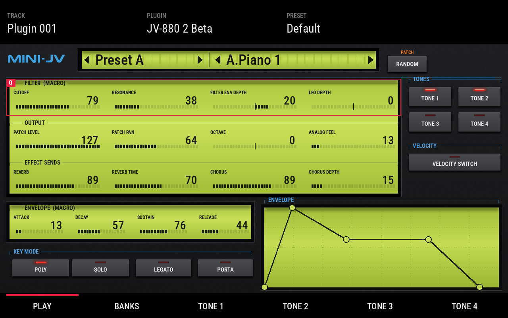
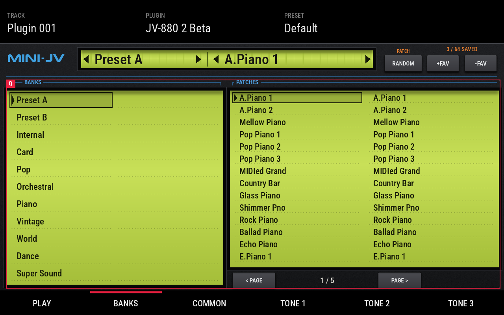

# MINI-JV (JV-880)
Roland JV-880 emulation as a VST2 instrument for Akai MPC and Force

💬 Questions or feedback? Join the [Open MPC Discord](https://discord.gg/sRRysZSgu3).

**JV-880** runs in MPC's built-in plugin host, with its own touchscreen skin and Q-Link support. Version 2.0 is rebuilt on
Akai's MPC Plugin SDK and runs on 64-bit MPCs (Live III and others) and 32-bit MPCs (Force, Live, Live II, One, X, Key). Projects saved with 1.x still load with their patch and edits.

Current release: see [Releases](https://github.com/sd88me/mpc-vst-jv880/releases).

## Features

- Roland JV-880 sample-based (ROM PCM) sound engine, with the JV-880's own reverb and chorus.
- A rack-style screen: matte black panel and red-LED keys. Every value sits on a backlit LCD, with its name, a big number
  and a bar graph. Drag a value, turn its Q-Link, or use the data wheel.
- **PLAY**:
  - Filter and envelope macros, output and effect sends.
  - A live ADSR display.
  - Tone on/off, velocity switch and key mode.
- **BANKS**: every bank and its patches as LCD lists. Tap a bank to browse it, tap a patch to load it.
- **COMMON**: bend and portamento, reverb and chorus in full, with type keys, and key mode.
- **TONE 1–4**: wave, filter, amp and pitch, plus the tone's pitch, filter and amp envelopes as live, draggable displays.
  Press the TONE key again for the two LFOs.
- **RANDOM** loads a random patch from any bank.
- **Favourites** in MPC's own PRESET list:
  - **+FAV** opens an on-screen keyboard on the patch's name. Type a name (up to 20 characters) and press **SAVE** to
    store the patch with your edits under it, or **CANCEL**. Pick it from the PRESET list on the track or from a pad.
  - **−FAV** removes the favourite that is currently picked.
  - Up to 64, shared by every project, stored in `jv880-favourites.dat` in the plugin folder.
- **SR-JV80 expansion cards** (01–19, and the 2 MB Experience cards 97–99) load automatically and appear as extra banks
  after the 3 built-in ones, up to 32 cards and 64 banks in all.
- MIDI control as in 1.x: CC 20–35 on the main controls, and NRPN for every parameter. In patch mode the plugin answers on
  every MIDI channel.

 

## ROMs (required, not included)

The plugin makes no sound without your own JV-880 ROM dump, which must be **v1.0.0**. A v1.0.1 dump causes CPU traps in
the emulated H8/300 core. The ROMs and any SR-JV80 expansion cards are copyrighted Roland firmware, so they are not
included anywhere in this repo or its release zip.

Put them in `jv880-roms/roms/` inside the plugin folder, and expansion cards in `jv880-roms/roms/expansions/`.
[docs/ROMS.md](docs/ROMS.md) has the five exact file names and sizes (the names must match), where the plugin folder is for
each install type, and the expansion card rules.

## Install

Needs MPC OS 3.x (3.10.1 or later for the `-sdk` zip). Version 2.0's screen uses skin features MPC OS 2.x doesn't have: on 2.x, stay on 1.0.9.
Download from the [latest release](https://github.com/sd88me/mpc-vst-jv880/releases/latest):

There are two plugin formats. Use one of them, not both: they are the same plugin.

- **SDK format** (MPC OS 3.10.1 or later): **`JV-880-<version>-mpc-sdk.zip`**, installed by hand. Unzip it and copy the folder
  `sd88me - VST - JV-880` into a folder named exactly `VST2 Plugins` at the root of a drive the MPC can see. Put your ROMs in
  its `jv880-roms/roms/`. Then, in Preferences > Enhancements, turn on Enable Enhancements and External Plugin Support, and
  restart the MPC.
- **Older format** (plugins listed in `MPC.settings`): **`JV-880-<version>-mpc-armv7.zip`** (Force, MPC Live / Live II, One, X,
  Key) or **`-mpc-aarch64.zip`** (Live III and other 64-bit MPCs). Install it either way:
  - **With the OpenMPC Plugin Manager:** install JV-880 from it, then add your ROMs with its **Your ROMs and files** step.
  - **By hand over SSH** (needs root shell access):
    ```
    scp -r JV-880-<version> root@<device-ip>:/tmp/
    ssh root@<device-ip> sh /tmp/JV-880-<version>/install.sh
    ```
    On a 64-bit unit, add `-t /nvme/Synths` to the install command. The installer stops the MPC, so save your project first.
    The zip's `INSTALL.md` has the manual steps and the uninstall command. Then copy your ROMs into the plugin folder's
    `jv880-roms/roms/`.

  Either way, a 1.x install is upgraded in place, and your ROMs (`jv880-roms/`) and favourites (`jv880-favourites.dat`) are kept.

Then add **JV-880** to a track from the plugin browser.

**Upgrading the SDK format:** copy the new folder over the old one (merge it, don't delete the old folder first) so
`jv880-roms/` and `jv880-favourites.dat` stay.

## Backing up your favourites and sounds

Your favourites and your own files are kept in the plugin folder on the MPC, not in your projects (a project keeps only the sound its
track uses). Back them up before you update the plugin or MPC OS, reset the device, or move to another MPC. These are the files to keep,
inside the plugin folder `sd88me - VST - JV-880`:

| File or folder | What it holds |
|---|---|
| `jv880-favourites.dat` | your favourites (+FAV) |
| `jv880-roms/` | your ROMs and expansion cards |

Your ROMs are yours to keep with your backup, but don't share them.

### Where the plugin folder is
It is in `VST2 Plugins` on one of the MPC's drives, or in a Synths folder (`/sdcard/Synths`, or `/nvme/Synths` on a Live III),
depending on how JV-880 was installed. Over SSH (root access), this prints its path:

```bash
ssh root@<device-ip> 'find /sdcard /nvme /media -maxdepth 3 -type d -name "sd88me - VST - JV-880" 2>/dev/null'
```

### Backing up
- **The plugin folder is on an SD card or USB drive:** plug the drive into a computer and copy the files above to it.
- **Over SSH**, from a computer: this copies the whole plugin folder into one file, `jv880-backup.tar`. Put the folder that holds the
  plugin folder (the path above without its last part) in place of `<parent folder>`:

  ```bash
  ssh root@<device-ip> 'cd "<parent folder>" && tar cf - "sd88me - VST - JV-880"' > jv880-backup.tar
  ```

### Restoring
Install JV-880 first (on the new device, or after the reset or update), then put back only the files above. Don't copy the whole
old folder over the new one: that would put the old version of the plugin back too.

- **From a drive:** copy the files back to the same places in the new plugin folder.
- **Over SSH:** unpack the backup on your computer and send the files back. List only the ones your backup has, and put the new
  plugin folder's path (found as above) in place of `<plugin folder>`:

  ```bash
  mkdir jv880-backup && tar xf jv880-backup.tar -C jv880-backup
  tar cf - -C "jv880-backup/sd88me - VST - JV-880" "jv880-favourites.dat" "jv880-roms" | ssh root@<device-ip> 'cd "<plugin folder>" && tar xf -'
  ```

Then remove JV-880 from its tracks and add it again (or reopen the project), so it reads the restored files.

## Build from source

Needs a checkout of Akai's MPC Plugin SDK (`mpc-plugin-builder-sdk`); set `MPC_SDK` to point at it.

```
./build-sdk.sh            # build/"sd88me - VST - JV-880"/ (arm32 + arm64 .so, skin)
./build-sdk.sh test       # also the offline ASan/UBSan host test (needs your ROMs: JV_ROMS, default ~/roms/jv880)
./build-sdk.sh beta       # "JV-880 2 Beta" (own uid), installs next to the release
tools/package.sh          # test, then dist/JV-880-<version>-mpc-{armv7,aarch64,sdk}.zip + SHA256SUMS
python3 tools/make_tui.py --preview   # regenerate skins/ and docs/skin-preview/*.png
```

How the source is laid out:
- `src/JV880Plugin.cpp`: the SDK front end around the unchanged engine (`src/dsp/`).
- Parameters: `params.json` holds the frozen 1.x order, and `params.lock` keeps it append only.
  `tools/sdk/gen_sdk_params.py` writes `src/params_gen.h` from them.
- The skin is generated by `tools/make_tui.py`, with page layouts in `tools/skin_pages.py` and art in
  `tools/make_jv_skin.py`.

The 1.x build files (`build.sh`, `release.sh`, `vst.json`, `layout.conf`, `skin.css`, `module.json`) are kept for
reference only.

## Background

The sound engine is a vendored copy of [schwung-jv880](https://github.com/charlesvestal/schwung-jv880), a `plugin_api_v2`
build of the JV-880's H8/300 MCU and PCM wavetable emulator originally written for Ableton Move. `src/VENDORED.md` lists
what is vendored, from which commit, and the local changes.

More detail:
- [docs/ROMS.md](docs/ROMS.md): ROM and expansion staging.
- [docs/HANDOFF-SDK-PORT.md](docs/HANDOFF-SDK-PORT.md): how the 2.0 port is built and tested.
- [docs/DESIGN-NOTES.md](docs/DESIGN-NOTES.md): 1.x design notes.

## Credits

- **Roland**: the original JV-880 hardware and its ROMs (not included).
- **[nukeykt](https://github.com/nukeykt)**: the H8/300 MCU + PCM emulation core
  (originally written for [Nuked-SC55](https://github.com/nukeykt/Nuked-SC55)).
- **[giulioz](https://github.com/giulioz)**: [mini-jv880](https://github.com/giulioz/mini-jv880) / juce-jv880, which
  adapted that core into a JV-880 emulator.
- **[charlesvestal](https://github.com/charlesvestal)**: [schwung-jv880](https://github.com/charlesvestal/schwung-jv880),
  the `plugin_api_v2` build this port vendors.
- **[sd88me](https://github.com/sd88me)**: this MPC port, and [force-jv880](https://github.com/sd88me/force-jv880).
- Roboto Condensed (SIL OFL, `tools/fonts/`) for the skin's printed text.
