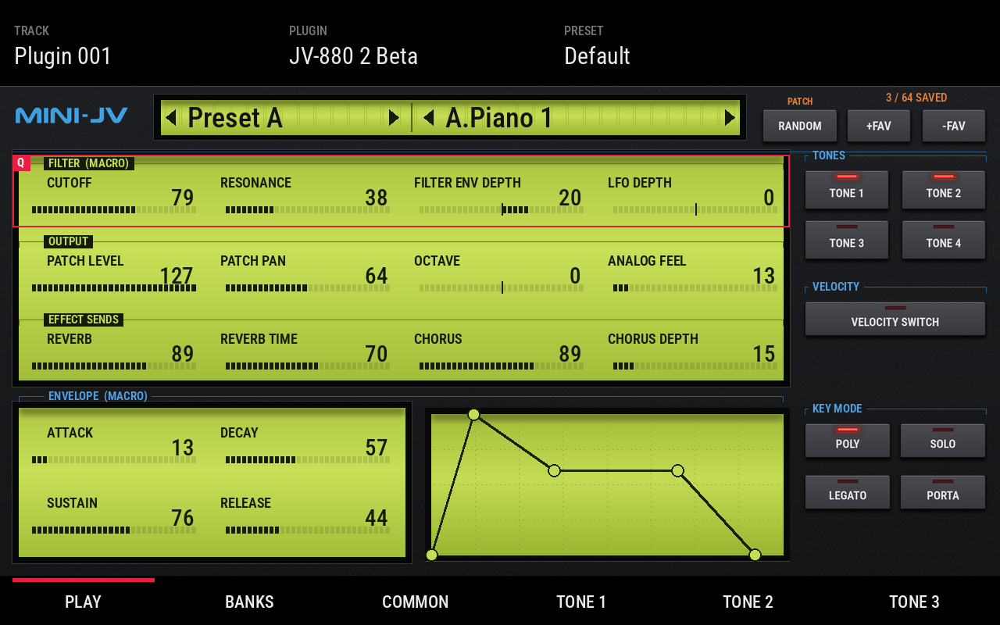
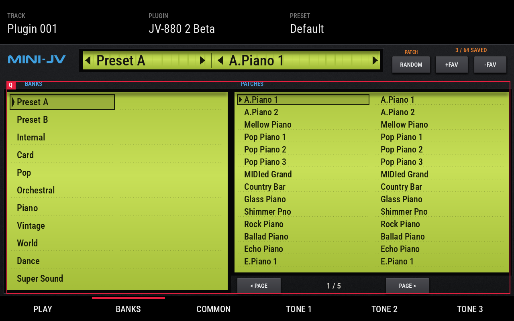

# MINI-JV (JV-880)
Roland JV-880 emulation as a VST2 instrument for Akai MPC and Force

💬 Questions or feedback? Join the [Open MPC Discord](https://discord.gg/sRRysZSgu3).

**JV-880** runs in MPC's built-in plugin host, with its own touchscreen skin and Q-Link support. Version 2.0 is rebuilt on
Akai's MPC Plugin SDK and runs on 64-bit MPCs (Live III and others) and 32-bit MPCs (Force, Live, Live II, One, X, Key). Projects saved with 1.x still load with their patch and edits.

Current release: see [Releases](https://github.com/sd88me/mpc-vst-jv880/releases).

## Features

- Roland JV-880 sample-based (ROM PCM) sound engine, with the JV-880's own reverb and chorus.
- A rack-style screen: matte black panel and red-LED keys. Every value sits on a backlit LCD, with its name, a big number
  and a bar graph. Drag a value, turn its Q-Link, or use the data wheel.
- **PLAY**:
  - Filter and envelope macros, output and effect sends.
  - A live ADSR display.
  - Tone on/off, velocity switch and key mode.
- **BANKS**: every bank and its patches as LCD lists. Tap a bank to browse it, tap a patch to load it.
- **COMMON**: bend and portamento, reverb and chorus in full, with type keys, and key mode.
- **TONE 1–4**: wave, filter, amp and pitch, plus the tone's pitch, filter and amp envelopes as live, draggable displays.
  Press the TONE key again for the two LFOs.
- **RANDOM** loads a random patch from any bank.
- **Favourites** in MPC's own PRESET list:
  - **+FAV** saves the current patch with your edits. Pick it from the PRESET list on the track or from a pad.
  - **−FAV** removes the favourite that is currently picked.
  - Up to 64, shared by every project, stored in `jv880-favourites.dat` in the plugin folder.
- **SR-JV80 expansion cards** load automatically and appear as extra banks: up to 19 cards in addition to the 3 built-in
  banks.
- MIDI control as in 1.x: CC 20–35 on the main controls, and NRPN for every parameter.

 

## ROMs (required, not included)

The plugin makes no sound without your own JV-880 ROM dump, which must be **v1.0.0**. A v1.0.1 dump causes CPU traps in
the emulated H8/300 core. The ROMs and any SR-JV80 expansion cards are copyrighted Roland firmware, so they are not
included anywhere in this repo or its release zip.

Put them in `jv880-roms/roms/` inside the plugin folder, and expansion cards in `jv880-roms/roms/expansions/`.
[docs/ROMS.md](docs/ROMS.md) has the exact file names and sizes.

## Install

Needs MPC OS 3.x. Version 2.0's screen uses skin features MPC OS 2.x doesn't have: on 2.x, stay on 1.0.9.
Download from the [latest release](https://github.com/sd88me/mpc-vst-jv880/releases/latest):

- **`JV-880-<version>-mpc-sdk.zip`**, for MPCs that load plugin folders from `VST2 Plugins`. Unzip it and copy the folder
  `sd88me - VST - JV-880` into a folder named exactly `VST2 Plugins` at the root of a drive the MPC can see. Put your ROMs in
  its `jv880-roms/roms/`. Then, in Preferences > Enhancements, turn on Enable Enhancements and VST2 Support, and restart
  the MPC.
- **`JV-880-<version>-mpc-armv7.zip`** (Force, MPC Live / Live II, One, X, Key) and **`-mpc-aarch64.zip`** (Live III and
  other 64-bit MPCs), for MPCs that list plugins in `MPC.settings`. Both need root shell access:
  ```
  scp -r JV-880-<version> root@<device-ip>:/tmp/
  ssh root@<device-ip> sh /tmp/JV-880-<version>/install.sh
  ```
  On a 64-bit unit, add `-t /nvme/Synths` to the install command. The installer stops the MPC, so save your project first.
  A 1.x install is upgraded in place, and your ROMs (`jv880-roms/`) and favourites (`jv880-favourites.dat`) are kept.
  The zip's `INSTALL.md` has the manual steps and the uninstall command.

Then add **JV-880** to a track from the plugin browser.

**Upgrading by hand:** replace the plugin folder, but keep `jv880-roms/` and `jv880-favourites.dat`.

## Build from source

Needs a checkout of Akai's MPC Plugin SDK (`mpc-plugin-builder-sdk`); set `MPC_SDK` to point at it.

```
./build-sdk.sh            # build/"sd88me - VST - JV-880"/ (arm32 + arm64 .so, skin)
./build-sdk.sh test       # also the offline ASan/UBSan host test (needs your ROMs: JV_ROMS, default ~/roms/jv880)
./build-sdk.sh beta       # "JV-880 2 Beta" (own uid), installs next to the release
tools/package.sh          # test, then dist/JV-880-<version>-mpc-{armv7,aarch64,sdk}.zip + SHA256SUMS
python3 tools/make_tui.py --preview   # regenerate skins/ and docs/skin-preview/*.png
```

How the source is laid out:
- `src/JV880Plugin.cpp`: the SDK front end around the unchanged engine (`src/dsp/`).
- Parameters: `params.json` holds the frozen 1.x order, and `params.lock` keeps it append only.
  `tools/sdk/gen_sdk_params.py` writes `src/params_gen.h` from them.
- The skin is generated by `tools/make_tui.py`, with page layouts in `tools/skin_pages.py` and art in
  `tools/make_jv_skin.py`.

The 1.x build files (`build.sh`, `release.sh`, `vst.json`, `layout.conf`, `skin.css`, `module.json`) are kept for
reference only.

## Background

The sound engine is a vendored copy of [schwung-jv880](https://github.com/charlesvestal/schwung-jv880), a `plugin_api_v2`
build of the JV-880's H8/300 MCU and PCM wavetable emulator originally written for Ableton Move. `src/VENDORED.md` lists
what is vendored, from which commit, and the local changes.

More detail:
- [docs/ROMS.md](docs/ROMS.md): ROM and expansion staging.
- [docs/HANDOFF-SDK-PORT.md](docs/HANDOFF-SDK-PORT.md): how the 2.0 port is built and tested.
- [docs/DESIGN-NOTES.md](docs/DESIGN-NOTES.md): 1.x design notes.

## Credits

- **Roland**: the original JV-880 hardware and its ROMs (not included).
- **[nukeykt](https://github.com/nukeykt)**: the H8/300 MCU + PCM emulation core
  (originally written for [Nuked-SC55](https://github.com/nukeykt/Nuked-SC55)).
- **[giulioz](https://github.com/giulioz)**: [mini-jv880](https://github.com/giulioz/mini-jv880) / juce-jv880, which
  adapted that core into a JV-880 emulator.
- **[charlesvestal](https://github.com/charlesvestal)**: [schwung-jv880](https://github.com/charlesvestal/schwung-jv880),
  the `plugin_api_v2` build this port vendors.
- **[sd88me](https://github.com/sd88me)**: this MPC port, and [force-jv880](https://github.com/sd88me/force-jv880).
- Roboto Condensed (SIL OFL, `tools/fonts/`) for the skin's printed text.
